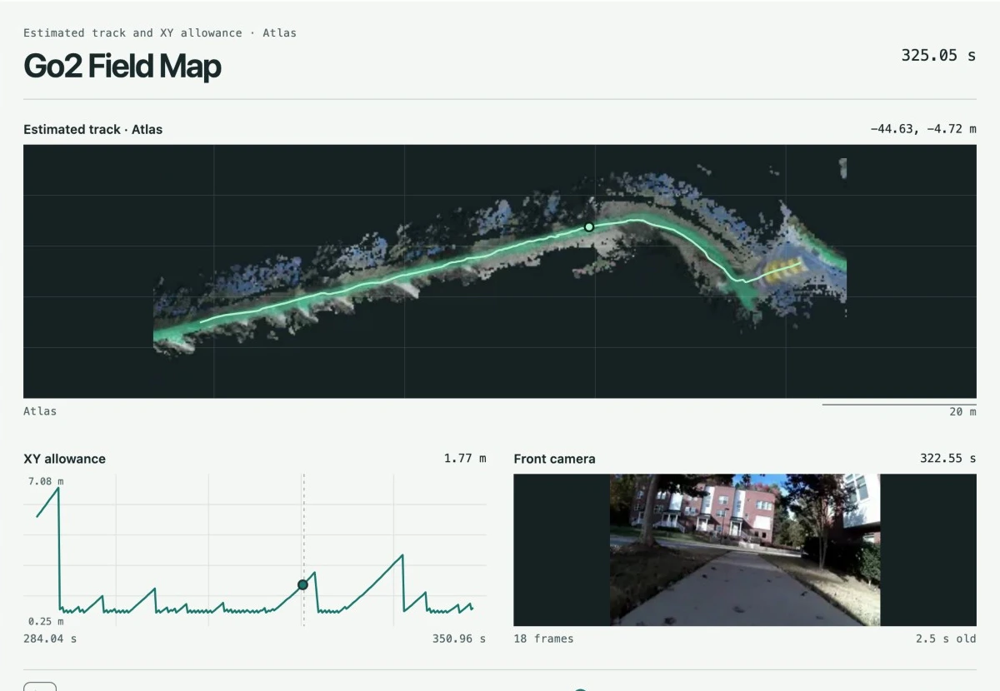
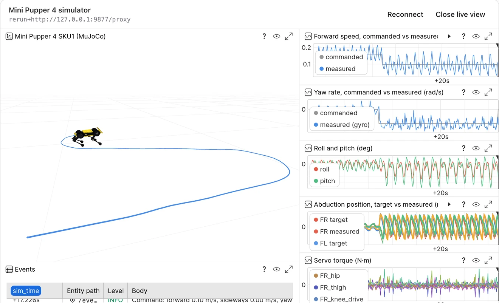
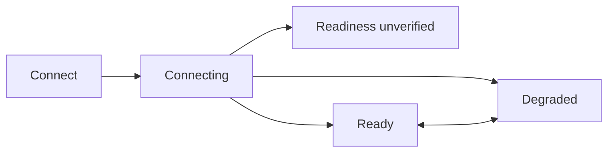

# Robot Code


Robot Code is an open-source workspace for building and debugging robot software with coding agents. Watch a robot move, pause a recording where its behavior changes, and give your agent the exact timestamp and entities to investigate.



The Go2 field map follows one walk. Scrub to a bend in the path to see the front camera frame available at that instant and how old it was. The example and its data run offline. [Build the recording tile](./docs/user/recording-tiles.md)

## Run from source

Install [Vite+](https://viteplus.dev/guide/), then run these commands from the checkout.

```sh
vp i
vp run dev
```

Open the pairing URL printed by the development server. For Electron, use `vp run dev:desktop`. The iOS and Android clients can connect to the same environment. [Mobile setup](./apps/mobile/README.md)

## Watch a robot

Open **Robotics** under a project and choose **Connect**. A registered robot can start an approved telemetry bridge and show its Rerun stream on web or desktop. In this Mini Pupper simulation, the trajectory sits beside commanded and measured speed. Pick a turn and follow the yaw rate, body tilt, and joint motion together. [Set up a live view or try the simulated arm](./docs/user/robotics-live-view.md)



## Investigate a run

Open **Evaluations → Experiment history** to follow a baseline and its subsequent runs. A result records the revision, setup, measurements, and fingerprints of its evidence. Open a replay citation to jump to a recorded decision. Here, three camera views show what the navigation policy saw, alongside its predicted map, requested step, and the evaluator’s collision map. [Publish and replay an evaluation](./docs/user/evaluations.md)


To investigate with an agent, open a project `.rrd` file in a conversation, pause it, select the relevant entities, and choose **Annotate → Add to chat**. Your draft carries the observation and a reference to that version of the recording. [Annotate a recording](./docs/user/robotics-recordings.md)

## Safety model

**Connection and readiness.** An operator registers the robot on the environment host. **Connect** can start approved, non-actuating bridges. A passing probe means the robot met the configured readiness criterion. For a telemetry freshness guarantee, the probe itself must check sample age. [Register a robot and configure its probe](./docs/user/robotics-connections.md)



**Managed processes.** The operator chooses each job’s executable, arguments, working directory, and resource claims on the host. The agent can inspect jobs and logs. Changing a session or job through the robotics tools requires a live project conversation with Full Access in Default mode. A claim reserves its resource among jobs on that environment. [Managed processes](./docs/user/robotics-processes.md)

**Physical command authority.** The robotics tools expose observation and process management. The repository includes a simulated command receiver to exercise exclusive writer leases, handoff, rejection of stale commands, and a watchdog that returns the receiver to its safe state when commands stop. Physical deployment requires enforcement at the robot’s command receiver, a robot-local watchdog, and an independent emergency stop. [Run the authority simulation](./docs/operations/robotics-authority.md)

## License and credits

Robot Code is an independent, unofficial fork of [T3 Code](https://github.com/pingdotgg/t3code). We thank the upstream contributors for the agent workspace this project builds on. T3 Tools, Inc. has no affiliation with Robot Code and does not maintain or endorse it. The Robot Code name and inspection robot identify this fork. [MIT License](./LICENSE) · [Trademark policy](./TRADEMARK.md)
