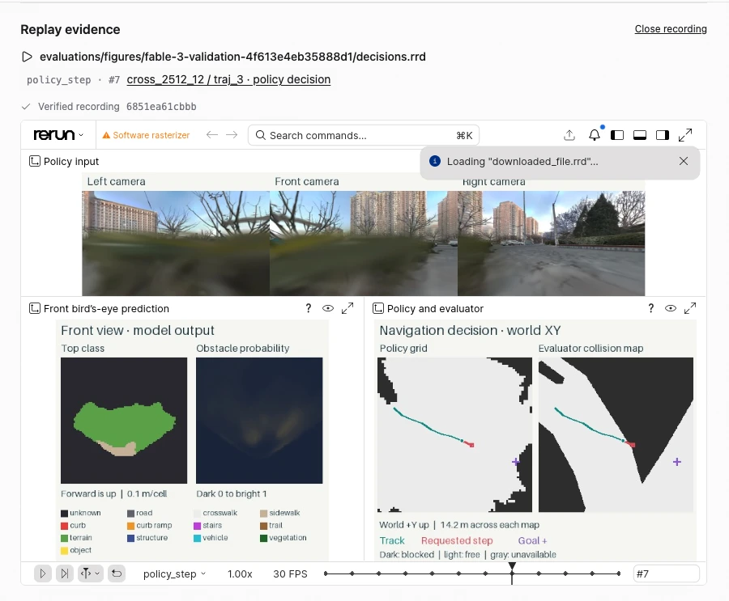
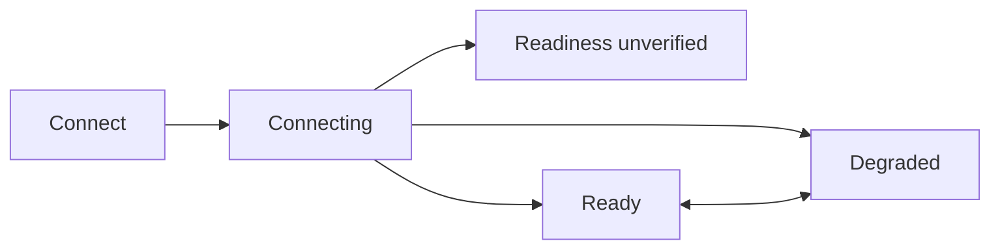

# Robot Code


Robot Code is an open-source app for building and debugging robot software with a coding agent. You can watch a robot live or replay a recording. If the robot takes a wrong turn, pause there and ask your agent to look at that moment.


Pick a bend in the path to see what the front camera saw. The map and camera share a timeline. You can try this recording offline. [Build the field map](./docs/user/recording-tiles.md)

## Run from source

Install [Vite+](https://viteplus.dev/guide/). Run these commands in the project folder.

```sh
vp i
vp run dev
```

Open the pairing link printed in your terminal. To run the desktop app, use `vp run dev:desktop`. You can also connect from an iPhone or Android device. [Mobile setup](./apps/mobile/README.md)

## Set up a robot

Open your robot’s project and ask your coding agent to set it up in Robot Code. Try this in a project chat.

> Set up my rover in Robot Code. Check what’s already configured for this project and ask me for any connection details you still need.

You can start while the robot is offline. Once it’s registered, you’ll find it under **Robotics** in the project sidebar. When the robot is online, choose **Connect** to run its setup and any readiness checks you’ve configured. [Robot connection guide](./docs/user/robotics-connections.md)

## Watch a robot live

If your robot has a live view, it opens when you connect from the web or desktop app. You can also ask your agent to build one.

> Give my robot a live view. Show its 3D model next to a plot of target and measured joint positions.


The blue line shows where Mini Pupper walked. The speed plot shows how fast it was told to go and how fast it went. [Set up a live view](./docs/user/robotics-live-view.md)

## Review a run with your agent

Open **Evaluations → Experiment history** to compare runs. Each report saves the code version, setup, and results. Follow a replay link to see what happened at a specific step. [Publish and replay a run](./docs/user/evaluations.md)



At step seven, you can see what the robot saw, where it tried to go, and which parts of the map the evaluator marked as blocked.

To ask your agent about a moment, open a project recording (`.rrd`) in a chat. Pause it, select the parts you want to discuss, and choose **Annotate → Add to chat**. Your draft includes your note and a reference to that version of the recording. [Annotate a recording](./docs/user/robotics-recordings.md)

## Safety model

**What does Ready mean?** An operator registers the robot on the computer running Robot Code. **Connect** can start approved programs that read robot data. **Ready** means the robot passed the operator’s check. If you need to know whether a sensor is sending fresh data, the check must look at the age of its last reading. [Set up a readiness check](./docs/user/robotics-connections.md)



**What can an agent run?** The operator chooses each approved program, how it starts, and which resources it reserves. Two managed jobs on the same host cannot reserve the same resource at once. An agent can read job status and logs. To change a job or robot session with the robotics tools, it needs a live project chat with **Full Access** in **Default** mode. [Manage robot jobs](./docs/user/robotics-processes.md)

**What controls motion?** The robotics tools let an agent observe a robot and manage approved jobs. On a physical robot, the part that receives motion commands must check who can send them. The robot also needs its own watchdog to stop motion if commands stop arriving, and an emergency stop that works independently of Robot Code.

You can try the command rules in a simulation. Only one sender has control at a time. When control passes to a new sender, the receiver rejects commands from the old one. [Run the safety simulation](./docs/operations/robotics-authority.md)

## License and credits

Robot Code is an independent, unofficial fork of [T3 Code](https://github.com/pingdotgg/t3code). We thank its contributors for the original coding workspace. T3 Tools, Inc. has no affiliation with Robot Code and does not maintain or endorse it. The Robot Code name and inspection robot identify this fork. [MIT License](./LICENSE) · [Trademark policy](./TRADEMARK.md)
